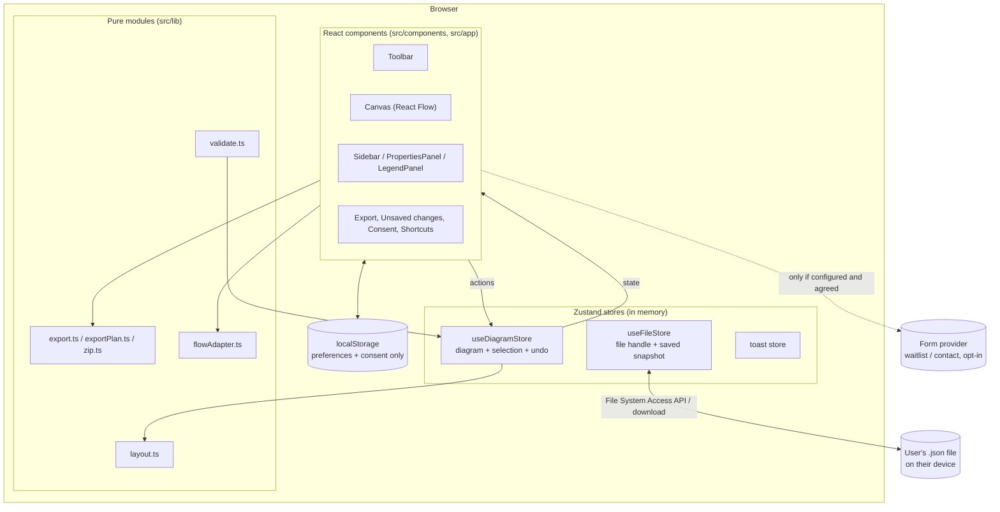
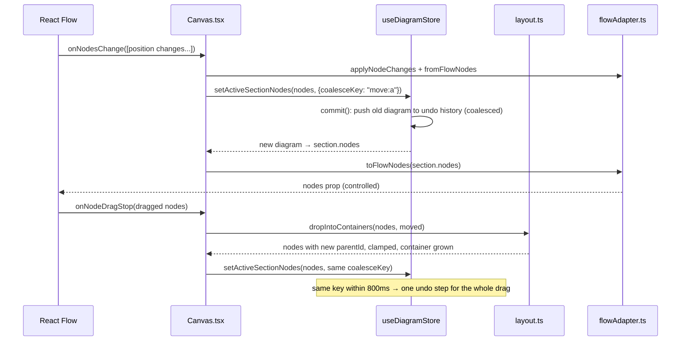
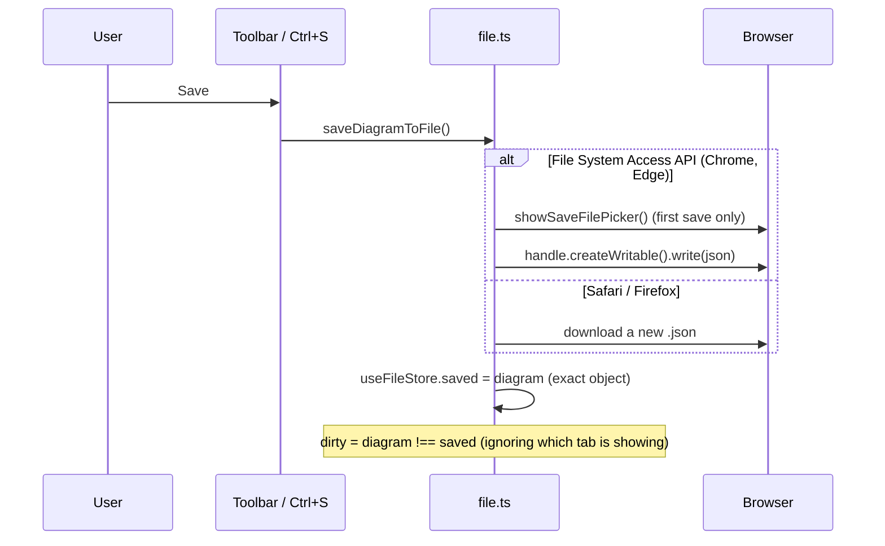
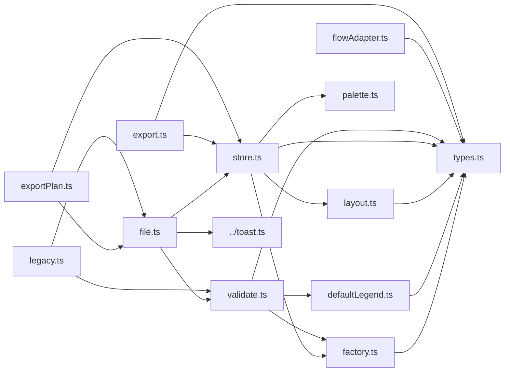

# 2. Architecture

## The big picture

Building Block is a **browser app with a thin server**. All diagram logic runs in the browser. The server only
renders the pages, per request so each carries a fresh Content-Security-Policy nonce, and runs the `proxy`
(maintenance mode and the policy), which reads environment variables per request.

## Layers

| Layer | Folder | Rules |
| --- | --- | --- |
| **Routes** | `src/app/` | Thin. A route renders a page component and declares metadata. Pages that need the browser are client components. |
| **Components** | `src/components/` | UI only. They read state with store selectors and call store actions; they don't mutate diagrams themselves. |
| **State** | `src/lib/diagram/store.ts`, `src/lib/diagram/file.ts`, `src/lib/toast.ts` | Zustand stores (or a tiny external store for toasts). The only place the open diagram changes. |
| **Domain logic** | `src/lib/diagram/*.ts`, `src/lib/*.ts` | Pure functions: layout maths, validation, export planning, CSV, ZIP, palette, consent. No React. This is what the unit tests cover. |
| **Templates** | `src/templates/` | Functions that build a starting diagram. |
| **Types** | `src/lib/diagram/types.ts`, `src/types/` | The data model, plus type declarations for the File System Access API that TypeScript's DOM library doesn't have yet. |

**Why pure modules:** everything that can be a pure function is one (`layout.ts`, `validate.ts`, `exportPlan.ts`,
`zip.ts`, `palette.ts`, `consent.ts`, `maintenance.ts`). They are tested without a browser, and the store and
components stay small.

## State: three stores, and why there are three

### `useDiagramStore` — `src/lib/diagram/store.ts`

Holds the open diagram, the selection and undo history. Every edit is an action on this store. See
[Diagram store and undo](05-diagram-store-and-undo.md).

### `useFileStore` — `src/lib/diagram/file.ts`

Holds what the diagram's *file* knows: whether a diagram is open at all (`opened`), the file handle Save writes
to, the file name, the exact diagram object last saved (`saved`), and whether a save is running or failed.

**Why separate from the diagram store:** file state isn't part of undo. Undoing an edit must not "un-save" the
file or forget the handle. Keeping them apart means `commit()` in the diagram store never has to think about files.

### The toast store — `src/lib/toast.ts`

A module-level list plus listeners, read with `useSyncExternalStore`. **Why not Zustand:** toasts are raised from
plain functions (`saveDiagramToFile`, `openDiagramFile`) that run outside React, and this is ~20 lines with no
dependency. See [Notifications](12-notifications.md).

## How a click becomes a change on the canvas

Example: the user drags a component into a container.

**Why React Flow is "controlled":** the store is the single source of truth. React Flow only *reports* changes
(`onNodesChange`, `onEdgesChange`, `onConnect`); the Canvas turns them into store actions, and React Flow
re-renders from the store. That is what makes undo, autosave and dirty tracking work for every kind of change.
The translation between our `DiagramNode` and React Flow's `Node` lives in `src/lib/diagram/flowAdapter.ts`.

## How the diagram reaches the file

See [Files, saving and unsaved changes](06-files-saving-and-unsaved-changes.md).

## Dependency map of `src/lib/diagram`

`store.ts` must never import `file.ts`, or saving would become part of undo and the modules would import each other.
`file.ts` reads the store; the store knows nothing about files.

## Client and server components

Most of the app is client-side (`"use client"`) because it needs the browser: React Flow, the stores, file
pickers, `localStorage`. Server components are used where nothing interactive is needed:

| Server components | Why |
| --- | --- |
| `src/app/layout.tsx` | Fonts, metadata, the theme provider shell. |
| `src/app/page.tsx` (landing) | Pure content; pre-rendered for speed and SEO. Interactive bits (`ThemeToggle`, `WaitlistForm`, `CurrentYear`) are client islands. |
| `src/app/privacy/page.tsx`, `src/app/contact/page.tsx` | Content pages; the withdraw button and the form are client islands. |
| `src/app/maintenance/page.tsx` | Reads the maintenance message per request (`await connection()`). |
| `src/app/not-found.tsx`, `src/app/editor/page.tsx` | Trivial wrappers. |

**Trap — reading browser state during render:** a client component is still rendered on the server once (for the
static HTML). Anything that reads `window`, `localStorage` or `navigator` must not change the first render, or
React reports a hydration mismatch. The codebase uses `useSyncExternalStore(subscribe, getSnapshot,
getServerSnapshot)` with a safe server value for this: see `useMounted()` in `src/components/theme-toggle.tsx`,
the consent gate, the legacy-diagram finder on the start page, and `CurrentYear`.
