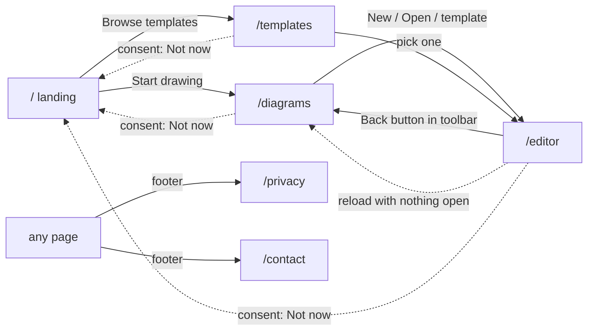

# 3. Routing

Next.js App Router: each folder under `src/app/` with a `page.tsx` is a URL. This page lists every route, what
renders it, and every rule that sends a visitor somewhere else.

## Route table

| URL | File | Rendering | Purpose | Consent needed |
| --- | --- | --- | --- | --- |
| `/` | `src/app/page.tsx` | Static | Landing page: product pitch, features, roadmap, waitlist | No |
| `/diagrams` | `src/app/diagrams/page.tsx` | Static, client | Start page: new diagram, open a file (or drop one), templates, old-version leftovers | **Yes** |
| `/templates` | `src/app/templates/page.tsx` | Static, client | All templates with previews | **Yes** |
| `/editor` | `src/app/editor/page.tsx` → `EditorApp` | Static, client | The editor. Only works when a diagram is open in memory | **Yes** |
| `/privacy` | `src/app/privacy/page.tsx` | Static | Privacy notice, acceptance status, withdraw button | No |
| `/contact` | `src/app/contact/page.tsx` | Static | Contact form | No |
| `/maintenance` | `src/app/maintenance/page.tsx` | **Dynamic** (per request) | "We're updating" page, shown by the proxy | No |
| anything else | `src/app/not-found.tsx` | Static | 404 page | No |

Icons are file-convention routes: `src/app/favicon.ico`, `src/app/icon.svg`, `src/app/apple-icon.png`.

**Why `/maintenance` is dynamic:** its message and end time come from environment variables that can change
without a rebuild. `await connection()` in the page tells Next.js to render it per request instead of at build
time.

## Navigation flows



## Rules that redirect or block

### 1. `/editor` with no open diagram → `/diagrams`

`EditorApp` checks `useFileStore.opened`. A diagram only exists in memory, so a direct link to `/editor`, a reload,
or a bookmark has nothing to show; the effect calls `router.replace("/diagrams")`.

```ts
// src/components/editor/EditorApp.tsx
useEffect(() => {
  if (!opened) router.replace("/diagrams");
}, [opened, router]);
```

**Why `replace`, not `push`:** the empty editor shouldn't be in history, or Back would bounce the user straight
back to the redirect.

**Why a reload goes back to the start page instead of restoring:** restoring would mean keeping a copy of the
diagram in the browser, which principle 1 forbids. The tab-close warning (`beforeunload`) fires first while there
are unsaved changes.

### 2. Leaving the editor closes the diagram — except the browser's Back button

The toolbar's back button goes through the unsaved-changes guard, then sets `opened: false` and navigates to
`/diagrams`. The **browser's** Back button can't be intercepted in the App Router, so the diagram stays in memory,
still `opened`. To keep principle 3, the start page and the templates page run the **same unsaved-changes guard**
before New, Open, a template, or a dropped file replaces it (`useUnsavedGuard`, see
[files](06-files-saving-and-unsaved-changes.md#the-unsaved-changes-guard)).

**Trap:** `beforeunload` does *not* fire for client-side navigation. Before this guard existed, Back then "New
blank diagram" silently discarded work.

### 3. The consent gate

`src/components/ConsentGate.tsx` is mounted once in the root layout and reads `usePathname()`. On `/diagrams`,
`/templates` and `/editor` (and any sub-path) it shows the privacy notice until it has been accepted. **Not now**
goes to `/`. See [consent](11-privacy-consent-and-forms.md#the-consent-gate).

**Why in the layout, not each page:** one place, and it survives client-side navigation between app pages.
**Why the landing, privacy and contact pages are open:** people must be able to read the privacy notice, and
contact us, before agreeing to anything.

### 4. The proxy: maintenance mode — `src/proxy.ts`

Next.js 16 renamed *middleware* to **proxy** (`export function proxy`). It runs on the server for every request
matching:

```ts
matcher: ["/((?!_next/static|_next/image|.*\\.[\\w]+$).*)"]
```

i.e. every page, but not framework assets or any path with a file extension (icons, images). **Why:** during
maintenance the maintenance page itself still needs its CSS, JS and icons.

Behaviour, in order:

| Condition | Response |
| --- | --- |
| `MAINTENANCE_MODE` is off and the URL is `/maintenance` | `307` redirect to `/`: nothing to wait for, so nobody is left on that page |
| `MAINTENANCE_MODE` is off | Pass through |
| `?preview=<MAINTENANCE_BYPASS_TOKEN>` is in the URL | Set the `bb_maintenance_bypass` cookie (HttpOnly, SameSite=Lax, Secure on HTTPS, 12 hours), `307` to the same URL without the token |
| The bypass cookie matches the token | Pass through (the team can check a release before reopening) |
| Otherwise | **Rewrite** to `/maintenance` with status **503**, `Retry-After`, `Cache-Control: no-store` |

Design details and why:

- **Rewrite, not redirect.** The address bar keeps the page the visitor asked for, so the maintenance page can
  check that same URL and reload when the site is back.
- **503 for every page, including `/maintenance` itself.** The maintenance page decides "we're back" by fetching
  its own URL and checking for anything other than 503. Before this rule, someone who landed on `/maintenance`
  directly got 200, so the page thought the site was back and reloaded every 30 seconds.
- **`Retry-After`** tells crawlers and clients when to try again: the seconds until `MAINTENANCE_UNTIL`, or 300 if
  that is unset or past (`retryAfterSeconds()` in `src/lib/maintenance.ts`).
- **`no-store`** so a CDN doesn't cache the maintenance page as the real page.
- **The token is removed from the URL** after setting the cookie, so it isn't left in history or shared links.

Configuration is in [Operations](16-operations.md#maintenance-mode-runbook).

## Error boundaries

| File | Catches | What it offers |
| --- | --- | --- |
| `src/app/error.tsx` | A crash in any page except the editor | Try again (`retry()`), go to the start page. Reassures that saved files are unaffected. |
| `src/app/editor/error.tsx` | A crash inside the editor | **Download the diagram as JSON** (the store lives outside React, so the diagram survives the crash), **Undo last change and try again**, Try again, Start page. |
| `src/app/not-found.tsx` | Unknown URLs | Links to the start page and home. |

**Why the editor has its own boundary:** a crash there could otherwise lose unsaved work. Because Zustand state is
module-level, the error component can still read the diagram and offer it as a download, and offer undoing the
edit that probably caused the crash.

**Next.js 16 note:** error components receive `retry` (stable since 16.3), not the older `reset`.

## Response headers on every route

Set in `next.config.ts` for `/:path*` (see [Security](14-security.md#http-headers)):

`X-Content-Type-Options: nosniff`, `Referrer-Policy: strict-origin-when-cross-origin`, `X-Frame-Options: DENY`,
`Content-Security-Policy: frame-ancestors 'none'`, `Permissions-Policy: camera=(), microphone=(), geolocation=()`,
and `poweredByHeader: false` removes `X-Powered-By`.

## Root layout — `src/app/layout.tsx`

Wraps every page:

- Loads the Geist fonts with `next/font/google` (self-hosted at build time, so the browser never contacts Google;
  the privacy notice relies on this).
- `viewport`: `viewportFit: "cover"` so the app can draw under notches and pad itself with `env(safe-area-inset-*)`;
  `themeColor` per colour scheme.
- `<html suppressHydrationWarning>`: `next-themes` adds the `dark` class before React hydrates; without this React
  would warn about the class differing.
- `ThemeProvider` (`attribute="class"`, `defaultTheme="system"`, `disableTransitionOnChange` so switching themes
  doesn't animate every colour).
- `ToastViewport` and `ConsentGate`, once for the whole app.
