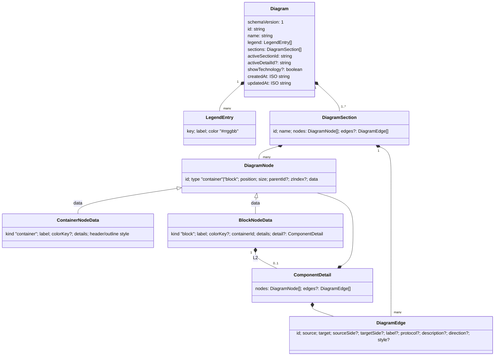

# 4. Data model and file format

All types are in `src/lib/diagram/types.ts`. The saved `.json` file is exactly a `Diagram` serialised with
`JSON.stringify(diagram, null, 2)`, so this page is also the file-format specification.

## The types



### `Diagram`

| Field | Meaning | Why it's like this |
| --- | --- | --- |
| `schemaVersion: 1` | File format version. | Lets a future version migrate old files, and lets this version refuse files from a newer one instead of misreading them. |
| `id` | Random id (`diagram_xxxxxxxx`). | Identifies the diagram; not used for storage (there is none). |
| `name` | Shown in the toolbar; used for file names and export titles. | Never empty in practice: the toolbar resets a blank name to "Untitled Diagram". |
| `legend` | The categories, in display order. | Per diagram, because different practices use different categories. |
| `sections` | The tabs. Always at least one. | |
| `activeSectionId` | Which tab is open. | Saved, so a file reopens on the tab it was saved on. **Navigation, not content:** ignored by dirty tracking. |
| `activeDetailId` | The component in the active tab whose internal design (L2) is open. | Same as above: reopening a file returns to where you were, but opening a design isn't an edit. |
| `showTechnology` | Show `[technology]` under component names. Absent means `true`. | Optional so older files keep their default. |
| `createdAt`, `updatedAt` | ISO timestamps. `updatedAt` changes on every edit (`touch()` in the store). | Informational. |

### `LegendEntry`

`key` is an opaque id (`legend_xxxxxxxx` for new entries; the default legend uses readable keys like
`"microservice"`). Nodes refer to entries by `key`, never by colour or label, so renaming or recolouring a category
updates every component at once. `color` is always `#rrggbb` because the native colour input only accepts that
form.

### `DiagramSection` (a tab)

`nodes` holds containers and components in one array; `edges` holds connections. `edges` is optional because
files from before connections existed don't have it.

### `DiagramNode`

| Field | Meaning |
| --- | --- |
| `type` | `"container"` or `"block"` (a component). |
| `position` | Top-left corner. **Relative to the parent container** when `parentId` is set, otherwise canvas coordinates. This is React Flow's convention, kept so no conversion is needed when rendering. |
| `size` | Width and height in canvas pixels. |
| `parentId` | The container a component sits in. Only components have one, and only containers can be parents. |
| `zIndex` | Optional stacking order. |
| `data` | `ContainerNodeData` or `BlockNodeData`, told apart by `data.kind`. |

**Why `data.kind` as well as `type`:** TypeScript narrows unions by a field *inside* the object; `node.data.kind`
lets code that only has `data` (e.g. React Flow node components) know which kind it has. They always agree.

### `NodeDetails` (shared by both kinds)

`technology`, `owner`, `description`, `notes`, all optional strings. Blank values are stored as `undefined`
(the store's `updateNodeDetails` converts them), so they don't appear in saved files.

### `ContainerNodeData`

`label`, optional `colorKey`, the details above, and `ContainerStyle`: `headerPosition` (`top` default, `bottom`,
`left`, `right`), `headerAlign` (`start` default, `center`, `end`), `outlineColor` (defaults to the category
colour, or grey), `outlineStyle` (`solid` default, `dashed`). Every style field is optional so defaults can change
without rewriting files.

### `BlockNodeData`

`label`, optional `colorKey` (undefined means *unassigned*: drawn white with a dashed border), the details,
`containerId` (mirrors `parentId`; kept for older code paths and the CSV), and optional `detail`: the component's
internal design (L2).

### `ComponentDetail` (L2)

`{ nodes, edges? }`: the same shapes as a tab, minus id and name. **One level deep:** nodes inside a detail
never have their own `detail`. Absent until something is drawn in it, and removed again when emptied.

### `DiagramEdge` (a connection)

| Field | Meaning | Default |
| --- | --- | --- |
| `source`, `target` | Component ids **in the same canvas** (tab or internal design). Never a container, never the same id. | |
| `sourceSide`, `targetSide` | `top`/`right`/`bottom`/`left`: which handle the line attaches to. | React Flow picks |
| `label` | What flows, e.g. "Orders". | |
| `protocol` | How, e.g. "REST", "Kafka". | |
| `description` | Free text. | |
| `direction` | `forward` (arrow at target), `both`, `none`. | `forward` |
| `style` | `solid` or `dashed` (dashed is the usual convention for asynchronous calls). | `solid` |

## Example file

```json
{
  "schemaVersion": 1,
  "id": "diagram_k3j9x0a1",
  "name": "Payments platform",
  "legend": [
    { "key": "microservice", "label": "Microservices", "color": "#1f7a4d" },
    { "key": "third-party", "label": "3rd Party Systems", "color": "#e5e7eb" }
  ],
  "sections": [
    {
      "id": "section_a1b2c3d4",
      "name": "Current",
      "nodes": [
        {
          "id": "container_q1w2e3r4", "type": "container",
          "position": { "x": 80, "y": 80 }, "size": { "width": 320, "height": 220 },
          "data": { "kind": "container", "label": "Core Platform" }
        },
        {
          "id": "block_z9x8c7v6", "type": "block", "parentId": "container_q1w2e3r4",
          "position": { "x": 16, "y": 40 }, "size": { "width": 140, "height": 56 },
          "data": {
            "kind": "block", "label": "Orders", "colorKey": "microservice",
            "containerId": "container_q1w2e3r4", "technology": "Java",
            "detail": {
              "nodes": [
                { "id": "block_in000001", "type": "block", "position": { "x": 0, "y": 0 },
                  "size": { "width": 140, "height": 56 },
                  "data": { "kind": "block", "label": "Orders API", "containerId": null } }
              ]
            }
          }
        },
        {
          "id": "block_p0o9i8u7", "type": "block",
          "position": { "x": 520, "y": 120 }, "size": { "width": 140, "height": 56 },
          "data": { "kind": "block", "label": "Stripe", "colorKey": "third-party", "containerId": null }
        }
      ],
      "edges": [
        { "id": "edge_m1n2b3v4", "source": "block_z9x8c7v6", "target": "block_p0o9i8u7",
          "label": "Payments", "protocol": "REST" }
      ]
    }
  ],
  "activeSectionId": "section_a1b2c3d4",
  "createdAt": "2026-10-20T09:00:00.000Z",
  "updatedAt": "2026-10-20T09:30:00.000Z"
}
```

## Invariants

The store and the validator together keep these true. Code may rely on them.

1. A diagram has at least one section, and `activeSectionId` names one of them.
2. Node ids are unique within their canvas (a tab, or one internal design). Section ids are unique.
3. Only components have `parentId`, it names a **container in the same canvas**, and containers have no parent
   (one level of nesting).
4. A component's `data.containerId` equals its `parentId` (or `null`).
5. Every edge joins two different components that exist in the same canvas. Deleting a component deletes its
   edges (`withoutDanglingEdges` in the store).
6. `colorKey`, when set, names an entry in `legend`. Removing a legend entry unassigns it everywhere, including
   inside internal designs.
7. Internal designs are one level deep and never empty (an emptied one is removed).
8. Colours are `#rrggbb`.

## Ids — `createId()` in `src/lib/diagram/factory.ts`

`${prefix}_${8 random base-36 characters}`, e.g. `block_k3j9x0a1`. **Why not UUIDs:** shorter, readable in a
saved file, and ids only need to be unique within one diagram, not globally. Copies always get fresh ids
(paste, duplicate, duplicate tab, templates).

`factory.ts` also builds blank sections and diagrams (`createBlankDiagram` copies `DEFAULT_LEGEND` so editing one
diagram's legend never changes the defaults) and `defaultLabel(type)` ("Untitled" / "Untitled Container"), used
whenever a name is left blank.

## How files are read — `validate.ts`

`parseDiagram(input)` turns anything (a parsed file, an old `localStorage` entry) into a diagram the editor can
render safely. It returns `{ diagram, fixes }`, where `fixes` are human-readable notes about every repair,
shown to the user in a warning toast.

**Why repair instead of reject:** a file that is mostly fine (one bad connection, a missing size) should open.
Rejecting it would leave the user with no way to recover their work. Only input that isn't a diagram at all
throws `DiagramFileError`, whose message is shown to the user.

### When a file is rejected

| Input | Message |
| --- | --- |
| Not an object | "That file isn't a Building Block diagram." |
| `schemaVersion` is a number greater than 1 | "That diagram was made by a newer version of Building Block." |
| `schemaVersion` isn't `1`, or `sections` isn't an array | "That file isn't a Building Block diagram." |
| Not valid JSON (in `parseDiagramFile`) | "That file isn't a valid JSON file." |

### What is repaired, and how

| Part | Rule | Fix note |
| --- | --- | --- |
| Legend missing | Use the default legend. | "The legend was missing…" |
| Legend entry without a key, with a duplicate key, or without a valid colour | Dropped. | "Skipped N invalid legend entries." |
| Colour `#abc` | Expanded to `#aabbcc` (valid CSS, so accepted silently). | — |
| Node without an id or with an unknown type | Dropped. | "skipped N items that couldn't be read" |
| Duplicate node id | Later one dropped. | "skipped N duplicate items" |
| Missing or non-numeric label, position or size | Defaults: label "Untitled"/"Untitled Container", position 0,0, size 160×56 (component) or 320×220 (container). | "filled in or corrected… for N items" |
| Size above 10,000 or position beyond ±100,000 | Capped. Larger values would stall rendering and export. | same note |
| Detail fields (`technology` etc.) | Kept if text (numbers converted), trimmed; blanks dropped. | — |
| `colorKey` not in the legend | Dropped (the node becomes unassigned). | — |
| Container style values not in the allowed lists | Dropped (defaults apply). | — |
| `parentId` naming something that isn't a container, or a container having a parent | Parent removed; position converted to canvas coordinates so the node stays where it was on screen. | "took N items out of a container…" |
| Connection not joining two different, existing components; duplicate id; missing id | Dropped. | "skipped N connections that didn't join two components" |
| `edges` present but not an array | All dropped. | "skipped connections that couldn't be read" |
| `detail` that isn't an object | Ignored. | "skipped the internal design of X, which couldn't be read" |
| `detail` nested inside a `detail` | Removed (one level deep). | "removed N internal designs nested inside an internal design" |
| Empty `detail` | Removed. | — |
| Duplicate section id | Given a new id. Tabs and undo key on section ids. | — |
| No sections | One blank section. | — |
| `activeSectionId` not found | First section. | — |
| `activeDetailId` not a component in the active section | Dropped (opens at L1). | — |
| Missing `id`, `name`, `createdAt`, `updatedAt` | New id; "Imported diagram"; now. | — |

**Trap — trusting the file's shape:** the parser never spreads raw objects into the diagram. Every field is read
explicitly and checked (`text()`, `finite()`, `oneOf()`, `hexColor()`), so unexpected keys (including
`__proto__`) can't sneak into the store, and a hostile file can't inject markup (React escapes text, and SVG
export escapes it again).

The rules are covered by `tests/lib/diagram/validate.test.ts` and `tests/lib/diagram/detail.test.ts`.
