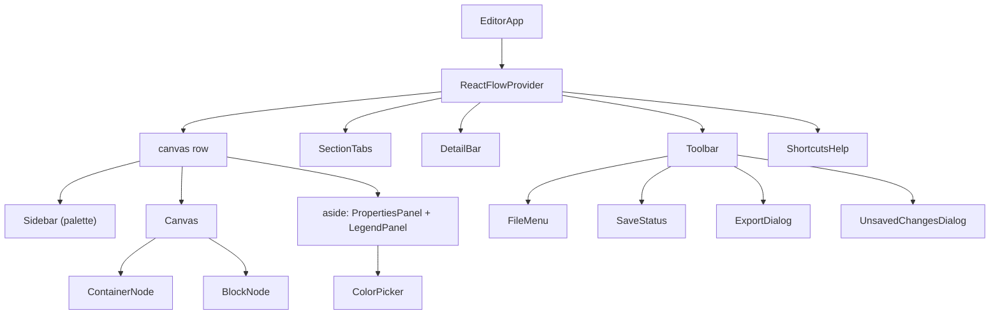

# 7. Editor UI — `src/components/editor/`

## Component tree

Everything sits inside `ReactFlowProvider` because the Toolbar (exports: `getNodes`, `getNodesBounds`) and
Sidebar (adding at the canvas centre: `screenToFlowPosition`) need React Flow's API, not just the Canvas.

## `EditorApp.tsx` — the shell

Responsibilities, top to bottom:

1. **Redirect when nothing is open** (`router.replace("/diagrams")`, see [routing](03-routing.md#1-editor-with-no-open-diagram--diagrams)).
   Until then it renders a small "Go to the start page" link instead of an empty editor.
2. **Keyboard shortcuts** (a `window` keydown listener; list below).
3. **Autosave** (see [files](06-files-saving-and-unsaved-changes.md#autosave--in-editorapptsx)).
4. **`beforeunload` warning** while dirty. `event.preventDefault()` plus `returnValue = ""` is what browsers need to
   show their own "Leave site?" prompt (custom text isn't allowed any more).
5. **Layout:** toolbar, tabs, the L2 bar, then the row of palette / canvas / details. See [responsive layout](#responsive-layout).
6. **Collapsed panels** on wide screens, remembered in `localStorage["bb:panels"]` (`{ palette, properties }`).

### Keyboard shortcuts

| Keys | Action | Where handled |
| --- | --- | --- |
| Ctrl/⌘+S | Save (works even while typing in a field) | EditorApp |
| Ctrl/⌘+Shift+S | Save as | EditorApp |
| B | Add a component (inside the selected container, or the selected component's container) | EditorApp |
| C | Add a container | EditorApp |
| Arrow keys / Shift+arrows | Nudge selection 8 px / 32 px (`nudgeNodes`) | EditorApp |
| Delete / Backspace | Delete selected nodes or connection | React Flow (`deleteKeyCode`) |
| Esc | Close a drawer; clear the selection; with nothing selected, leave an internal design | EditorApp |
| Ctrl/⌘+A | Select everything in the view | EditorApp |
| Ctrl/⌘+C / X / V | Copy / cut / paste | EditorApp |
| Ctrl/⌘+D | Duplicate | EditorApp |
| Ctrl/⌘+Z, Ctrl/⌘+Shift+Z or Ctrl/⌘+Y | Undo, redo | EditorApp |
| ? | Show/hide the shortcuts list | EditorApp |
| ←/→, Home/End on a focused tab | Move between tabs | SectionTabs |

**When shortcuts are ignored:** if the event was already handled (`defaultPrevented`), Alt is held, or focus is in
an `input`, `textarea`, `select`, `contenteditable`, or inside a `role="dialog"`, `alertdialog` or `menu`. Text fields
keep their native undo, copy/paste and select-all; dialogs and menus don't add containers behind themselves.

**Why buttons are *not* excluded:** clicking a button focuses it in Chrome and Firefox. Excluding buttons used to
mean Ctrl+Z did nothing right after clicking the Undo button, and arrow keys did nothing after clicking Align.

## `Toolbar.tsx`

Left to right: **back** (logo; guarded, then closes the diagram and goes to `/diagrams`), **diagram name** input
(max 80 characters, auto-sized; a blank name becomes "Untitled Diagram" on blur, since it is used for file names),
**SaveStatus**, **File** menu, then undo/redo, the shortcuts button (only with a fine pointer, i.e. a mouse), the
theme toggle (hidden on phones), **Save**, **Export**.

- **File menu:** New diagram, Open…, Save (shows ⌘S or Ctrl+S depending on the platform), Save as… /
  *Download a copy* (without the File System Access API), plus an explanation when the browser can't save in place.
  The menu closes when focus leaves it or on Escape.
- **Export** opens the [export dialog](10-export.md). The toolbar owns the export *process* because it needs
  React Flow's API and the theme.

## `SectionTabs.tsx` — tabs

A `role="tablist"`. Each tab is a button with `role="tab"`, `aria-selected`, and **roving tabindex** (only the open
tab is in the Tab order; arrows move between tabs and open them). The open tab shows Rename (also on
double-click), Duplicate and Delete (only with more than one tab; asks "Delete?" first, cancelled by moving away).
Rename commits on Enter or blur; **Escape cancels**, using a ref so the blur some browsers fire as the field closes
doesn't save what was typed. "Add tab" is at the end.

Clicking the open tab again leaves an internal design (it calls `setActiveSection`, which clears `activeDetailId`).

## `DetailBar.tsx` — the L2 bar

Only rendered inside an internal design: "← Back to *tab* / *component* · L2 · Internal design". Back (or Esc with
nothing selected) calls `closeDetail()`.

## `Canvas.tsx` — React Flow

The canvas is a **controlled** React Flow: `nodes` and `edges` come from the store via `toFlowNodes`/`toFlowEdges`,
and every change React Flow reports is turned into a store action.

| Prop / handler | What and why |
| --- | --- |
| `key={section.id}` | Remounts React Flow when the view changes (tab or internal design), so each view gets its own viewport and `fitView`. |
| `onNodesChange` | Selection changes update the store selection. Moves, resizes, adds and removes update nodes, with an undo key from `historyOptionsFor` (moves and resizes are coalesced; pure measurements are ignored, so React Flow measuring nodes doesn't create undo steps). When a component inside a container is resized past its edge, the container grows. |
| `onNodeDragStop` | `dropIntoContainers(nodes, dragged)`: decides which container each dragged component is now in (into, out of, or across), with the same undo key as the drag. See [layout](08-layout-and-containers.md#drag-and-drop-re-parenting--dropintocontainers). |
| `onConnect` | `addConnection` with the handles' sides. |
| `isValidConnection` | Rejects connecting a component to itself while dragging. |
| `connectionMode={Loose}` | Every handle can start and end a connection, so there are 4 handles per component instead of 8. |
| `onEdgesChange` | Delete key → `deleteConnections`; clicking a connection → `setSelectedEdge`. |
| `onBeforeDelete` | When nodes are deleted, React Flow also reports their connections as deleted. The store already removes those, so they're filtered out here to keep it **one** undo step. |
| `onPaneClick` | Clears the selection. |
| `onDragOver` / `onDrop` | Palette drag-and-drop: drops a container centred on the cursor, or a component into the top-most container under the cursor (`findContainerAtPoint`), kept clear of its header. |
| `snapToGrid`, `snapGrid={[8, 8]}` | Tidy positions; matches the 8 px nudge step. |
| `minZoom 0.2`, `maxZoom 2`, `fitView` | Sensible zoom range; open fitted to content. |
| `selectionMode={Partial}` | Box selection includes nodes it only partly covers (easier on dense diagrams). |
| `colorMode` | Follows the app theme once mounted (avoids a hydration flash). |
| `<MiniMap>` | Only at ≥768px wide (`useIsWide` via `matchMedia`): on a phone it would cover the canvas. |

**Empty state:** an empty view shows a card with **Container** and **Component** buttons (adding at the centre of
what's on screen), a hint about C/B/? on devices with a mouse, and, inside an internal design, "What is *X* made of?".

### `flowAdapter.ts`

- `toFlowNodes` lists **containers first**: React Flow requires parents before their children.
- Components inside containers have **no `extent: "parent"`**: React Flow would otherwise clamp them inside their
  container while dragging, and they could never be dragged out. Re-parenting happens on drop instead.
- `fromFlowNodes` converts back (React Flow's `width`/`height` or measured size → `size`).
- `toFlowEdges` uses `smoothstep` lines, a wide (24 px) invisible hit area, the caption "What flows · Protocol",
  arrowheads by `direction`, dashes by `style`, and **explicit colours instead of React Flow's CSS variables**,
  because image export renders the DOM outside the canvas, where those variables are undefined.
- `historyKey(kind, ids)`: see [undo](05-diagram-store-and-undo.md#committing-changes-and-undo).

## Node components — `nodes/`

### `BlockNode.tsx` (a component)

- Filled with its category colour; **dashed border and white when unassigned** (tooltip says so); text colour
  chosen for contrast (`readableTextOn`).
- `NodeResizer` when selected (minimum 80×32).
- Four `Handle`s (`bb-handle` class), hidden until hover, selection, or while a connection is being dragged (CSS in
  `globals.css`); always visible on touch screens.
- Double-click to rename inline. Enter or blur saves (blank → "Untitled"); Escape cancels.
- `[technology]` under the name when "Show technology" is on.
- **Notes marker:** an amber "!" corner badge. Hovering shows the notes in a card **portalled to `document.body`**
  so it isn't clipped by the canvas or scaled by zoom.
- **L2 badge:** a blue "L2" pill when the component has an internal design; clicking it opens it. It stops click and
  double-click from reaching the node (which would select or rename it).

### `ContainerNode.tsx`

- Border colour: the outline colour, else the category colour, else grey; solid or dashed.
- The header can sit on any side: the box is a flex row/column (reversed for bottom/right), side headers are a
  28 px strip with vertical text (reading bottom-to-top on the left), and alignment maps to `justify-content`.
- `NodeResizer` is always active but only drawn on hover or selection, with minimum sizes computed from the
  components inside, so **resizing can never clip them**.
- When selected and not empty: a floating `NodeToolbar` with **Fit to contents** and **Tidy layout**.
- Double-click the header to rename; Escape cancels.

## `Sidebar.tsx` — the palette

One "Container" item and one "component" item per legend entry. Each item is draggable (`dataTransfer` type
`application/building-block-node`, JSON payload) **and** clickable/Enter/Space to add. **Why both:** touch screens
can't drag from a list into React Flow reliably, so a tap adds at the centre of what's on screen (or into the
selected container, below its lowest component via `nextSlotInContainer`). On small screens adding closes the
drawer so you see the result.

The collapse button sits on the "Containers" line (wide screens only).

## `PropertiesPanel.tsx` — details

Shows one of five panels depending on the selection. The collapse button is on the first title line of whichever
panel is showing (`PanelTitle`'s `action`).

| Selection | Panel | Contents |
| --- | --- | --- |
| A connection | **Connection** | From → To (click to select either end), What flows, Protocol, Description, Arrows (one way / both / none), Line (solid / dashed), Reverse, Delete |
| Several nodes | **N items selected** | Align (6), Distribute & size (4), Color all, Duplicate, Delete all |
| Nothing (on a tab) | **Diagram** | Show technology switch, Fit all containers (if any are nested), a how-to hint |
| Nothing (in an internal design) | **Internal design** | The component it belongs to, its technology and description, **its connections at L1**, Back |
| One node | **Component** / **Container** | "In *container*" link, Label (blank → default on blur), Color (legend swatches), Technology (components only), Owner, Description, Notes, then: Connections (list + "Connect to…" picker) and **Internal design (L2)** for components on a tab; Header, Outline and Layout (Tidy, Fit) for containers; Delete |

**Why "Connect to…" exists as well as dragging:** dragging between small handles is hard on touch screens and for
keyboard users. The picker suggests sensible sides with `suggestConnectionSides` (the sides facing each other).

## `LegendPanel.tsx` — categories

Each entry: a [ColorPicker](#colorpickertsx), an editable name (blank → "Untitled category" on blur), a usage count
(across every tab and internal design, via `everyNode`), and remove. Removing an entry that's in use asks
"Remove?" first (cancelled by moving away), because its components become unassigned. "Add" creates an entry with
the next unused palette colour and focuses its name.

## `ColorPicker.tsx`

A swatch button that opens a popover (`role="dialog"`):

- An 18-colour **named palette** (`src/lib/diagram/palette.ts`), a radiogroup with a check on the current colour.
  Picking applies and closes.
- A **dot on colours another category already uses**, with "also used by …" in the tooltip and accessible name, so
  people avoid giving two categories the same colour.
- **Custom colour:** the native picker (applies live) and a code field accepting `#abc`, `abc` or `#aabbcc`, with an
  inline error for anything else.
- Keyboard: focus starts on the current colour; arrows/Home/End move in the grid; Esc closes and returns focus.
- **Portalled and `position: fixed`**, because the side panels scroll and would clip an absolutely positioned
  popover. It flips above the trigger near the bottom of the screen, and **closes on scroll or resize** (it is
  positioned against the trigger, so it would otherwise be left behind).

Used by the legend (with "already used" hints) and container outlines.

## Dialogs

| Component | Role | Notes |
| --- | --- | --- |
| `UnsavedChangesDialog.tsx` | `alertdialog` | Save / Don't save / Cancel; second "Saved — Open…" step (see [files](06-files-saving-and-unsaved-changes.md#the-unsaved-changes-guard)). Esc and clicking outside cancel. |
| `ExportDialog.tsx` | `dialog` | See [Export](10-export.md#the-export-dialog--exportdialogtsx). |
| `ShortcutsHelp.tsx` | `dialog` | The shortcut list. Esc or clicking outside closes. |
| `ConsentGate.tsx` (in `src/components/`) | `dialog` | See [consent](11-privacy-consent-and-forms.md#the-consent-gate). |

## Other pieces

- **`PanelToggle.tsx`:** the collapse/expand button for side panels (hidden below `lg`). When a panel is collapsed,
  `EditorApp` renders a 40 px **rail** at that edge holding the expand button.
- **`Icon.tsx`:** the editor's stroke icons as SVG path strings on a 24×24 grid. One source so icons look consistent.
- **`useUnsavedGuard.tsx`:** see [files](06-files-saving-and-unsaved-changes.md#the-unsaved-changes-guard).

## Responsive layout

| Width | Palette and details | Minimap | Other |
| --- | --- | --- | --- |
| ≥1024px (`lg`) | Fixed side panels (240px / 288px), each collapsible to a rail | Shown | |
| 768–1023px | **Drawers** over the canvas, opened with **Add** and **Details & legend** buttons; a dimmed backdrop closes them | Shown | |
| <768px | Drawers | Hidden | Toolbar wraps; labels shorten ("Unsaved"); theme toggle hidden |

`globals.css` adds the touch rules: on coarse pointers, inputs are 16px (iOS zooms into smaller inputs), buttons
and tabs are at least 40px tall, React Flow controls and handles are bigger, connection handles are always
visible, `touch-action: manipulation` removes the double-tap-zoom delay, and safe-area padding utilities
(`pt-safe`, `pb-safe`, `px-safe`, …) keep content clear of notches. `prefers-reduced-motion` turns animations off.
