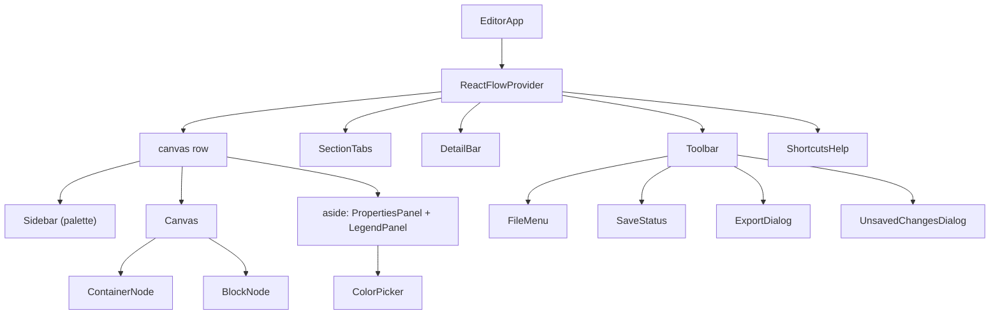

# 7. Editor UI — `src/components/editor/`

## Component tree

Everything sits inside `ReactFlowProvider` because the Toolbar (exports: `getNodes`, `getNodesBounds`) and
Sidebar (adding at the canvas centre: `screenToFlowPosition`) need React Flow's API, not just the Canvas.

## `EditorApp.tsx` — the shell

Responsibilities, top to bottom:

1. **Redirect when nothing is open** (`router.replace("/diagrams")`, see [routing](03-routing.md#1-editor-with-no-open-diagram--diagrams)).
   Until then it renders a small "Go to the start page" link instead of an empty editor.
2. **Keyboard shortcuts** (a `window` keydown listener; list below).
3. **Autosave** (see [files](06-files-saving-and-unsaved-changes.md#autosave--in-editorapptsx)).
4. **`beforeunload` warning** while dirty. `event.preventDefault()` plus `returnValue = ""` is what browsers need to
   show their own "Leave site?" prompt (custom text isn't allowed any more).
5. **Layout:** toolbar, tabs, the L2 bar, then the row of palette / canvas / details. See [responsive layout](#responsive-layout).
6. **Collapsed panels** on wide screens, remembered in `localStorage["bb:panels"]` (`{ palette, properties }`).

### Keyboard shortcuts

| Keys | Action | Where handled |
| --- | --- | --- |
| Ctrl/⌘+S | Save (works even while typing in a field) | EditorApp |
| Ctrl/⌘+Shift+S | Save as | EditorApp |
| Ctrl/⌘+F | Find (`SearchDialog`); works in view mode too | EditorApp |
| B | Add a component (inside the selected container, or the selected component's container) | EditorApp |
| C | Add a container | EditorApp |
| Arrow keys / Shift+arrows | Nudge selection 8 px / 32 px (`nudgeNodes`) | EditorApp |
| Delete / Backspace | Delete selected nodes or connection; a container holding components asks first (`requestDelete`) | React Flow (`deleteKeyCode`) |
| Esc | Close a drawer (not while typing in a field or in a dialog); clear the selection; with nothing selected, leave an internal design | EditorApp |
| Ctrl/⌘+A | Select everything in the view | EditorApp |
| Ctrl/⌘+C / X / V | Copy / cut / paste (cut takes a container's components with it, as the copy does) | EditorApp |
| Ctrl/⌘+D | Duplicate | EditorApp |
| Ctrl/⌘+G | Group the selected components in a new container (`groupNodes`) | EditorApp |
| Ctrl/⌘+Shift+G | Ungroup: remove the selected containers, or the ones holding selected components, keeping the components (`ungroup` in `deletePrompt.ts`, which says when connections to a container went with it) | EditorApp |
| Ctrl/⌘+Z, Ctrl/⌘+Shift+Z or Ctrl/⌘+Y | Undo, redo | EditorApp |
| ? | Show/hide the shortcuts list | EditorApp |
| ←/→, Home/End on a focused tab | Move between tabs | SectionTabs |

**When shortcuts are ignored:** if the event was already handled (`defaultPrevented`), Alt is held, or focus is in
an `input`, `textarea`, `select`, `contenteditable`, or inside a `role="dialog"`, `alertdialog` or `menu`. Text fields
keep their native undo, copy/paste and select-all; dialogs and menus don't add containers behind themselves.

**Why buttons are *not* excluded:** clicking a button focuses it in Chrome and Firefox. Excluding buttons used to
mean Ctrl+Z did nothing right after clicking the Undo button, and arrow keys did nothing after clicking Align.

## `Toolbar.tsx`

Left to right: **back** (logo; guarded, then closes the diagram and goes to `/diagrams`), **diagram name** input
(max 80 characters, auto-sized; a blank name becomes "Untitled Diagram" on blur, since it is used for file names),
**SaveStatus**, **File** menu, then undo/redo, the shortcuts button (only with a fine pointer, i.e. a mouse), the
theme toggle (hidden on phones), **Save**, **Export**.

- **File menu:** New diagram, Open…, Save (shows ⌘S or Ctrl+S depending on the platform), Save as… /
  *Download a copy* (without the File System Access API), plus an explanation when the browser can't save in place.
  The menu closes when focus leaves it or on Escape.
- **Export** opens the [export dialog](10-export.md). The toolbar owns the export *process* because it needs
  React Flow's API and the theme.

## `SectionTabs.tsx` — tabs

A `role="tablist"`. Each tab is a button with `role="tab"`, `aria-selected`, and **roving tabindex** (only the open
tab is in the Tab order; arrows move between tabs and open them). The open tab shows Rename (also on
double-click), Duplicate and Delete (only with more than one tab; asks "Delete?" first, cancelled by moving away).
Rename commits on Enter or blur; **Escape cancels**, using a ref so the blur some browsers fire as the field closes
doesn't save what was typed. "Add tab" is at the end.

Clicking the open tab again leaves an internal design (it calls `setActiveSection`, which clears `activeDetailId`).

### Compare tabs — `CompareDialog.tsx`

With two or more tabs, **Compare tabs** at the right of the tab bar opens a dialog (portalled to `<body>`, since a
dialog doesn't belong inside a `tablist`). It works in view mode too: comparing changes nothing.

- **From / To** default to the tab before the open one and the open one (or, on the first tab, the first and
  the second), because tabs usually run from "current" to "target". A swap button reverses them.
- The list comes from `compareSections` in `src/lib/diagram/compare.ts` (pure, tested in
  `tests/lib/diagram/compare.test.ts`): **added**, **removed** and **changed** components and containers, then
  connections, with each changed field as "before → after".
- **Matched by name, not id** (trimmed, case-insensitive). Duplicating a tab gives everything fresh ids, and to an
  architect "Billing" on both tabs is the same system. Connections match by their two ends and what flows; a
  connection between the same ends with a different label is a change, not a removal and an addition. Two-way
  and arrowless connections match whichever end they were drawn from.
- **Position and size are ignored**: moving a box isn't an architecture change. A component's category,
  container, icon, technology, owner, description, notes and internal design (compared by content, not ids) are.
- Picking an item opens its tab (the "from" tab for removed items) with it selected and zooms to it (`goTo` in
  `canvasFocus.ts`), and closes the dialog.
- **Show on canvas** stores the pair in `useCompareView` (`compareView.ts`): screen state, not part of the diagram,
  so it isn't saved, undone or counted as a change, and it carries the diagram's id so opening another diagram
  drops it. `changeMarksForView` (in `compare.ts`) gives the view on screen its marks: added and changed items on
  the "to" tab, removed ones on the "from" tab (where they still are), nothing in internal designs. Nodes get a
  `bb-change-*` class (outline and tag drawn in `globals.css` with literal colours, so exports include them);
  connections are drawn in the change's colour. `CompareBar.tsx` explains the colours, switches between the two
  tabs and stops it. Exports taken meanwhile add the marks' legend lines (see [export](10-export.md)).
- **Download change list (CSV)** writes `comparisonRows`: one row per added or removed item, one per changed field,
  through the same `toCsv` as the other exports (formula-injection safe).

### Find — `SearchDialog.tsx`

Ctrl/⌘+F or the magnifier in the toolbar. `searchDiagram` (`src/lib/diagram/search.ts`, tested) looks through every
tab and internal design: names starting with the query first, then names containing it, then technology, owner,
category, icon, description, notes, and connections by what flows, protocol and description, each saying which field
matched. Sequence tabs are searched too: participants by name, messages by what's sent and protocol, notes by their
text. Several words find what has every word somewhere, in any order ("orders kafka"); case and accents don't matter.
Matched words are highlighted, and past 50 results the list says to add a word. A combobox with a listbox: arrows
move, Enter or a click calls `goTo`, which opens the tab and internal design, selects the item and asks the canvas to
zoom to it.

**Speed:** the first search of a diagram builds an index of its normalised text (`prepareSearch`, run as the dialog
opens), kept in a `WeakMap` keyed by the diagram object; every edit makes a new object, so the index is never stale.
Each keystroke then only compares strings (about 1.6 ms at 2,000 components a tab), and the list follows the typing
through `useDeferredValue`.

**Zooming after a view change:** going to another view remounts the canvas, so `goTo` leaves a request in
`useCanvasFocus`. The canvas waits until those nodes are measured (and a frame more, after its own fit-to-everything),
then calls `fitView` on them and clears the request.

## `DetailBar.tsx` — the L2 bar

Only rendered inside an internal design: "← Back to *tab* / *component* · L2 · Internal design". Back (or Esc with
nothing selected) calls `closeDetail()`.

## `Canvas.tsx` — React Flow

The canvas is a **controlled** React Flow: `nodes` and `edges` come from the store via `toFlowNodes`/`toFlowEdges`,
and every change React Flow reports is turned into a store action.

| Prop / handler | What and why |
| --- | --- |
| `key={section.id}` | Remounts React Flow when the view changes (tab or internal design), so each view gets its own viewport and `fitView`. |
| `onNodesChange` | Selection changes update the store selection. Moves, resizes, adds and removes update nodes, with an undo key from `historyOptionsFor` (moves and resizes are coalesced; pure measurements are ignored, so React Flow measuring nodes doesn't create undo steps). When a component inside a container is resized past its edge, the container grows. |
| `onNodeDragStop` | `dropIntoContainers(nodes, dragged)`: decides which container each dragged component is now in (into, out of, or across), with the same undo key as the drag. See [layout](08-layout-and-containers.md#drag-and-drop-re-parenting--dropintocontainers). |
| `onConnect` | `addConnection` with the handles' sides. |
| `isValidConnection` | Rejects connecting a component to itself while dragging. |
| `connectionMode={Loose}` | Every handle can start and end a connection, so there are 4 handles per component instead of 8. |
| `onEdgesChange` | Delete key → `deleteConnections`; clicking a connection → `setSelectedEdge`. |
| `onBeforeDelete` | When nodes are deleted, React Flow also reports their connections as deleted. The store already removes those, so they're filtered out here to keep it **one** undo step. Goes through `requestDelete` (`deletePrompt.ts`): when a container that holds components is among the nodes, `DeleteContainerDialog` asks **Keep components** (the default) or **Delete everything** first. Nodes and selected connections are deleted in one undo step (`deleteNodes` with `edgeIds`). A box selection or Select all picks up a container's components with it, so deleting them silently was easy to do by accident. |
| `onPaneClick` | Clears the selection. |
| `onDragOver` / `onDrop` | Palette drag-and-drop: drops a container centred on the cursor, or a component into the top-most container under the cursor (`findContainerAtPoint`), kept clear of its header. |
| `snapToGrid`, `snapGrid={[8, 8]}` | Tidy positions; matches the 8 px nudge step. |
| `minZoom 0.2`, `maxZoom 2`, `fitView` | Sensible zoom range; open fitted to content. |
| `selectionMode={Partial}` | Box selection includes nodes it only partly covers (easier on dense diagrams). |
| `colorMode` | Follows the app theme once mounted (avoids a hydration flash). |
| `<MiniMap>` | Only at ≥768px wide (`useIsWide` via `matchMedia`): on a phone it would cover the canvas. |

**Empty state:** an empty view shows a card with **Container** and **Component** buttons (adding at the centre of
what's on screen), a hint about C/B/? on devices with a mouse, and, inside an internal design, "What is *X* made of?".

### `flowAdapter.ts`

- `toFlowNodes` lists **containers first**: React Flow requires parents before their children.
- Components inside containers have **no `extent: "parent"`**: React Flow would otherwise clamp them inside their
  container while dragging, and they could never be dragged out. Re-parenting happens on drop instead.
- `fromFlowNodes` converts back (React Flow's `width`/`height` or measured size → `size`).
- `toFlowNodes` adds a `bb-change-*` class to nodes marked by a comparison shown on the canvas.
- `toFlowEdges` uses the custom `connection` line (`edges/ConnectionEdge.tsx`, with `shape` and `bend` in `data`), a wide (24 px) invisible hit area, the caption "What flows · Protocol",
  arrowheads by `direction`, dashes by `style`, and **explicit colours instead of React Flow's CSS variables**,
  because image export renders the DOM outside the canvas, where those variables are undefined.
- `historyKey(kind, ids)`: see [undo](05-diagram-store-and-undo.md#committing-changes-and-undo).

## `SequenceCanvas.tsx` — sequence tabs

Shown instead of `Canvas` when the open tab has `kind: "sequence"`. An SVG at 1:1, laid out by `layoutSequence`:
drawn in Mermaid's own look (its default theme, or its dark theme): lavender participant boxes (or a stick figure for
an actor) across the top and repeated at the bottom, solid lifelines, then one row per step; numbers sit in a dot
where each arrow starts, notes are yellow. A participant with a legend colour is filled with it.

- **Adding a message:** press on a lifeline and drag to another (or back onto the same one for a call to itself);
  a dashed preview follows the pointer. It goes in between the rows around where you pressed, is selected, and the
  Mermaid code gets the cursor so it can be named there.
- **Selecting:** click a participant, message or note (selection is `sequenceSelection.ts`, separate from the
  canvas selection). Double-click puts the cursor in the Mermaid code. ←/→ move a selected participant, ↑/↓ a
  selected step; Delete removes it (a participant with its messages); Esc clears.
- **Colours are SVG attributes**, chosen from the theme, not Tailwind classes: the picture export copies
  `.bb-sequence-sheet`, and classes on SVG elements don't survive the copy.
- The left panel is the Mermaid code (below) instead of the palette, and there's no details panel or legend on the
  right: everything about a step is edited in the code. Box shortcuts (B, C, paste, duplicate) do nothing on a
  sequence tab.
- "Sequence" beside "Add tab" adds one; sequence tabs have a small icon and aren't offered in Compare tabs.
- The sheet is an SVG with `role="group"` (not `img`: it holds controls), and a note's lines are `tspan`s of one
  `text`, so it's read, and named, as one sentence.

### Mermaid code — `SequenceCode.tsx`

On a sequence tab the left panel (where the palette is on architecture tabs) is the tab as Mermaid
`sequenceDiagram` code. It collapses and expands like the palette, and its right edge drags to resize it (arrow keys
on the focused edge too; double-click resets; the width is remembered in `localStorage["bb:sequence-code-width"]`); on narrow screens **Code** opens it as a drawer,
in view mode too. *Write Mermaid code* on an empty tab shows it and puts the cursor in it.

- **Follows the sheet** until you type in it; then the sheet waits for **Apply** (or Ctrl/⌘+Enter), which replaces
  the sequence as one undo step. *Undo edits* goes back to the sheet's code. Edits are kept per tab.
- **What the code says** (`exportMermaid.ts`): `actor`/`participant` with an `as` alias when the name isn't a
  Mermaid id; `->>` call, `-)` async, `-->>` reply; the protocol in brackets after the text ("Place order (REST)");
  `Note over A,B:` with ` ` for line breaks; `autonumber` when messages are numbered; `;` and `#` written as
  `#59;`/`#35;`. Reading it back gives the same sequence (tested).
- **What Mermaid can't say is kept:** a participant whose name is unchanged keeps its id, colour, description and
  link to a component (`applySequenceCode`). A renamed one is a new participant, so a linked one loses its link.
- Code that isn't a sequence diagram shows why, under the code, and changes nothing; flattened blocks or skipped
  lines are listed in a toast after Apply.
- **Names:** writing a participant's display name ("Web Shop" for `participant WebShop as Web Shop`) means that
  participant, not a new one. In code that declares its participants, one that's only mentioned (usually a typo) is
  still added, as Mermaid does, and named in the toast.
- **Line numbers** in a gutter beside the code. Adding a participant or message on the sheet, or double-clicking
  one, puts the cursor at the end of its line (`mermaidLineOf`), so a new message can be named straight away.
- **Mermaid cheat sheet** under the code: the lines a sequence needs, open at first on a tab with no steps yet.
- **Copy**, and **.mmd** downloads the code with the tab's name as `title` (the import reads it back).
- In view mode the code is read-only.

## Import — `ImportDialog.tsx`

From **Import from draw.io or Mermaid** on the start page (opens a new diagram; dropping a `.drawio`, `.xml`,
`.mmd` or `.md` file there does the same) or **File › Import draw.io or Mermaid…** in the editor (adds tabs to the
open diagram, one undo step). Choose a file or paste text. A toast says what came in and lists anything simplified.
After a draw.io import, containers whose components overlap are re-arranged in a grid (`tidyOverlappingContainers` in
`layout.ts`) and the import notes say how many; containers that are already tidy keep draw.io's positions.
See the [decision log](17-decision-log.md#import-drawio-for-architecture-mermaid-for-sequences).

## Screen readers and keyboard focus on the canvas

- **Live region** (`Announcer.tsx`, sentences in `src/lib/diagram/describe.ts`): out of sight, `role="status"`, polite. It says
  what a selection is ("Orders, component in Back office. Category: New. Technology: Java. 2 connections. 1 open
  comment."), what a connection joins and carries, what was added or removed with the new count, and which tab or
  internal design you arrived on. Moving a box and typing say nothing. Changes within 250 ms are said once.
- **Names:** React Flow gives each box and connection `aria-label` (`flowAdapter.ts`): "Orders, component",
  "Connection from Web to Orders: Place order (REST)". A component also holds a hidden "Category: New" so colour isn't the only
  signal.
- **Landmarks:** the editor row is a `<main aria-label="Diagram editor">`.
- **Focus** is outlined on boxes and connections (`globals.css`), so Tab through the canvas is visible.
- **Dialogs:** every modal dialog uses `useDialogFocus` (see below).
- **Still to check by hand:** moving a box with the arrow keys is announced as nothing; drawing a connection is done in
  the details panel (**Connect to…**), which a screen-reader user should try on a real reader. Not yet tested with
  VoiceOver, NVDA or JAWS.

## Keyboard and focus in dialogs and menus

- Modal dialogs that use `useDialogFocus` (all of them: Check, Export, History, Compare, Import, Find, Shortcuts, Unsaved changes, Delete container) keep Tab and Shift+Tab inside, and return focus to the button
  that opened them when they close. New dialogs should use it too.
- The legend's **Reuse** menu is a real menu: it takes focus when opened, ↑ ↓ Home End move between items, Escape closes
  it and returns focus to its button, and a click elsewhere or Tab closes it.

## Comments, history and links

- **Comments** (details panel, for a component, container or connection): add, resolve or reopen, delete. Saved in the
  diagram (`comments`). **File → Merge comments from a file…** (`mergeCommentsFromDevice`) takes only the comments from
  another copy: new ones are added, ones resolved there become resolved, nothing is deleted or reopened, and
  comments about things not in this diagram are skipped and counted. Open comments are listed in **Check**.
- **Comment badges** (`nodes/CommentMarker.tsx`): a blue badge with the open-comment count at a component or container's
  top-left, and beside the middle of a connection. Clicking selects it and puts the cursor in the new-comment field. The
  badges carry the class `bb-comment-marker`, which `keepInPicture` leaves out of exported pictures.
- **File → Version history…** (`HistoryDialog`): save a named checkpoint, **Restore…** (asks, undoable), **Open as tabs to
  compare** (adds the checkpoint's architecture tabs as new tabs for **Compare tabs**), **What changed since** (the same comparison dialog, checkpoint tab on the left and the current tab on the right, with nothing added to the diagram; removed items are listed but can't be jumped to), or delete. Limit 20.
- **Link** field: shown with an *Open the link* anchor only if it is a plain http(s) address (`safeWebAddress`).

## Check before you share, and legend presets

- **Check** (tab bar, with a count): `HintsDialog` lists, from `diagramHints` (`src/lib/diagram/hints.ts`), components
  nothing connects to (only on a canvas that has connections at all), connections with no protocol, and L0 components
  with no owner, across every tab and internal design. Picking one opens it. Hints never block saving or exporting.
- **Legend → Reuse:** adds the categories of **C4** or **ArchiMate** (`LEGEND_PRESETS` in `defaultLegend.ts`), or of a
  legend file (**Add from a file…**), that the legend doesn't already have by name, as one undo step
  (`addLegendEntries`). **Save this legend to a file** downloads names and colours only (`legendFile.ts`); a whole
  diagram file works as a legend file too.
- **Templates → Start from a file…:** opens a diagram file as a *copy* (`openDiagramFromDevice({ asCopy: true })`): new
  id, no file handle, so Save asks where to put it and the original is never written over. This is how people reuse
  their own layout and legend without the app keeping templates in the browser.
- **Export → Branding:** a logo (scaled to a small PNG) and an accent colour, saved in the diagram (`branding`) and
  drawn in the title bar of PNG, SVG, PDF and the viewer.

## Node components — `nodes/`

### `BlockNode.tsx` (a component)

- Filled with its category colour; **dashed border and white when unassigned** (tooltip says so); text colour
  chosen for contrast (`readableTextOn`).
- `NodeResizer` when selected (minimum 80×32).
- Four `Handle`s (`bb-handle` class), hidden until hover, selection, or while a connection is being dragged (CSS in
  `globals.css`); always visible on touch screens.
- Double-click to rename inline. Enter or blur saves (blank → "Untitled"); Escape cancels.
- Its built-in icon, if it has one, left of the name in the text colour (so it reads on any category colour).
  Inline SVG paths from `componentIcons.ts`: no icon font or CDN, so offline use and exports work.
- `[technology]` under the name when "Show technology" is on.
- **Notes marker:** an amber note badge (a button). Hovering or focusing it shows the notes in a card **portalled to
  `document.body`** so it isn't clipped by the canvas or scaled by zoom; near the top of the screen the card opens
  below. Lines starting `Assumption:`, `Risk:`, `Open question:` or `Decision:` show as tags. Clicking the badge
  selects the node, shows the details panel (opening its drawer or expanding it, via `showDetails` in
  `detailsPanel.ts`) and focuses its Notes field; in view mode it pins the card open instead.
- **L2 badge:** a blue "L2" pill when the component has an internal design; clicking it opens it. It stops click and
  double-click from reaching the node (which would select or rename it).

### `ContainerNode.tsx`

- Border colour: the outline colour, else the category colour, else grey; solid or dashed.
- The header can sit on any side: the box is a flex row/column (reversed for bottom/right), side headers are a
  28 px strip with vertical text (reading bottom-to-top on the left), and alignment maps to `justify-content`.
- `NodeResizer` is always active but only drawn on hover or selection, with minimum sizes computed from the
  components inside, so **resizing can never clip them**.
- When selected and not empty: a floating `NodeToolbar` with **Fit to contents** and **Tidy layout**.
- Double-click the header to rename; Escape cancels.

## `Sidebar.tsx` — the palette

One "Container" item and one "component" item per legend entry. Each item is draggable (`dataTransfer` type
`application/building-block-node`, JSON payload) **and** clickable/Enter/Space to add. **Why both:** touch screens
can't drag from a list into React Flow reliably, so a tap adds at the centre of what's on screen (or into the
selected container, below its lowest component via `nextSlotInContainer`). On small screens adding closes the
drawer so you see the result.

The collapse button sits on the "Containers" line (wide screens only).

## `PropertiesPanel.tsx` — details

Shows one of five panels depending on the selection. The collapse button is on the first title line of whichever
panel is showing (`PanelTitle`'s `action`).

| Selection | Panel | Contents |
| --- | --- | --- |
| A connection | **Connection** | From → To (click to select either end), What flows, Protocol, Description, Arrows (one way / both / none), Line (solid / dashed), Reverse, Delete |
| Several nodes | **N items selected** | Align (6), Distribute & size (4), Color all, Grouping (Group in container; Ungroup when a container is involved), Duplicate, Delete all |
| Nothing (on a tab) | **Diagram** | Show technology switch, Fit all containers (if any are nested), a how-to hint |
| Nothing (in an internal design) | **Internal design** | The component it belongs to, its technology and description, **its connections at L1**, Back |
| One node | **Component** / **Container** | "In *container*" link, Label (blank → default on blur), Color (legend swatches), Icon (components only: None plus the built-in set), Technology (components only), Owner, Description, Notes (grows with the text; + Assumption / Risk / Open question / Decision starters), then: Connections (list + "Connect to…" picker, with Components and Containers groups; containers have it too) and **Internal design (L2)** for components on a tab; Header, Outline and Layout (Tidy, Fit, Ungroup) for containers; Group in container (components not in one); Delete |

**Why "Connect to…" exists as well as dragging:** dragging between small handles is hard on touch screens and for
keyboard users. The picker suggests sensible sides with `suggestConnectionSides` (the sides facing each other).

## `LegendPanel.tsx` — categories

Each entry: a drag handle, a [ColorPicker](#colorpickertsx), a name renamed by double-clicking it (or Enter/F2 when
focused; Enter or clicking away saves, Esc cancels, blank → "Untitled category"), a usage count (across every tab and
internal design, via `everyNode`), and remove. "Add" creates an entry with the next unused palette colour and opens
its name for editing.

- **Order** is the order the palette and exports show. Drag an entry by its handle (pointer events with pointer
  capture, so mouse and touch both work; a blue line marks where it will land), or focus the handle and press ↑/↓.
  Either is one undo step (`moveLegendEntry`). **Why not HTML drag-and-drop:** it doesn't work with touch.
- **Removing an entry that's in use** opens a box under it: how many items use it, and "Move them to" another
  category or "No category (unassigned)". `removeLegendEntry(key, replacement)` recolours every item, in every tab
  and internal design, in the same undo step. Esc or Cancel closes the box. Unused entries are removed at once.

## `ColorPicker.tsx`

A swatch button that opens a popover (`role="dialog"`):

- An 18-colour **named palette** (`src/lib/diagram/palette.ts`), a radiogroup with a check on the current colour.
  Picking applies and closes.
- A **dot on colours another category already uses**, with "also used by …" in the tooltip and accessible name, so
  people avoid giving two categories the same colour.
- **Custom colour:** the native picker (applies live) and a code field accepting `#abc`, `abc` or `#aabbcc`, with an
  inline error for anything else.
- Keyboard: focus starts on the current colour; arrows/Home/End move in the grid; Esc closes and returns focus.
- **Portalled and `position: fixed`**, because the side panels scroll and would clip an absolutely positioned
  popover. It flips above the trigger near the bottom of the screen, and **closes on scroll or resize** (it is
  positioned against the trigger, so it would otherwise be left behind).

Used by the legend (with "already used" hints) and container outlines.

## Dialogs

| Component | Role | Notes |
| --- | --- | --- |
| `UnsavedChangesDialog.tsx` | `alertdialog` | Save / Don't save / Cancel; second "Saved — Open…" step (see [files](06-files-saving-and-unsaved-changes.md#the-unsaved-changes-guard)). Esc and clicking outside cancel. |
| `ExportDialog.tsx` | `dialog` | See [Export](10-export.md#the-export-dialog--exportdialogtsx). |
| `ShortcutsHelp.tsx` | `dialog` | The shortcut list. Esc or clicking outside closes. |
| `DeleteContainerDialog.tsx` | `alertdialog` | Keep components / Delete everything / Cancel before deleting a container that holds components. Esc and clicking outside cancel. |
| `ConsentGate.tsx` (in `src/components/`) | `dialog` | See [consent](11-privacy-consent-and-forms.md#the-consent-gate). |

## Other pieces

- **`PanelToggle.tsx`:** the collapse/expand button for side panels (hidden below `lg`). When a panel is collapsed,
  `EditorApp` renders a 40 px **rail** at that edge holding the expand button.
- **`Icon.tsx`:** the editor's stroke icons as SVG path strings on a 24×24 grid. One source so icons look consistent.
- **`useUnsavedGuard.tsx`:** see [files](06-files-saving-and-unsaved-changes.md#the-unsaved-changes-guard).

## Responsive layout

| Width | Palette and details | Minimap | Other |
| --- | --- | --- | --- |
| ≥1024px (`lg`) | Fixed side panels (240px / 288px), each collapsible to a rail | Shown | |
| 768–1023px | **Drawers** over the canvas, opened with **Add** and **Details & legend** buttons; a dimmed backdrop closes them | Shown | |
| <768px | Drawers | Hidden | Toolbar wraps; labels shorten ("Unsaved"); theme toggle hidden |

`globals.css` adds the touch rules: on coarse pointers, inputs are 16px (iOS zooms into smaller inputs), buttons
and tabs are at least 40px tall, React Flow controls and handles are bigger, connection handles are always
visible, `touch-action: manipulation` removes the double-tap-zoom delay, and safe-area padding utilities
(`pt-safe`, `pb-safe`, `px-safe`, …) keep content clear of notches. `prefers-reduced-motion` turns animations off.
